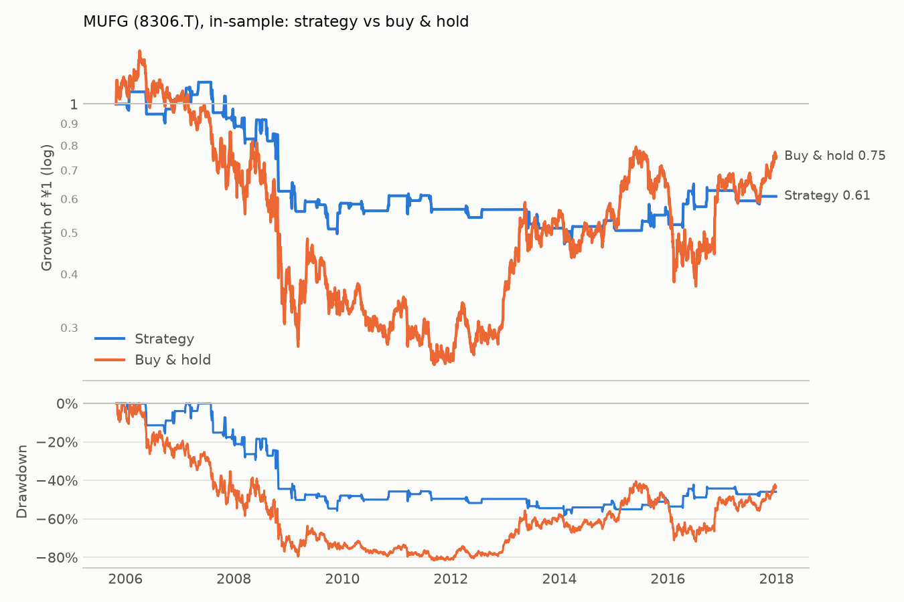

# MUFG (8306.T): in-sample

Period measured: 2005-10-31 to 2017-12-29

- Costs: 15 bps per side. Cash: JPY call rate, FRED `IRSTCI01JPM156N`.
- Rule: 5% below the 20-day MA, max hold 15 days, stop 10%, reset rule (see PREREGISTRATION.md).
- Data: `8306.T.csv` downloaded 2026-11-13, sha256 `0da8eee33cf79e22…`.

## Performance

| | CAGR | Vol | Sharpe | Max DD | In market | Trades | Win rate | Avg days | Avg trade | Gap trades |
|---|---:|---:|---:|---:|---:|---:|---:|---:|---:|---:|
| Strategy | -4.0% | 16.9% | -0.17 | -58.2% | 15.8% | 50 | 52.0% | 10.38 | -0.70% | 0 |
| Buy & hold | -2.3% | 36.5% | 0.11 | -81.6% | 100.0% | 0 | n/a | n/a | n/a | 1 |

## Trades

All 50 trades are in [trades.csv](trades.csv). Trades open across a data gap: 0.

### Why trades ended (closed trades)

| Exit | Trades | Win rate | Avg return | Sum of returns |
|---|---:|---:|---:|---:|
| back to MA | 25 | 100.0% | +5.37% | +1.34 |
| stop-loss | 8 | 0.0% | -12.15% | -0.97 |
| time stop | 17 | 5.9% | -4.24% | -0.72 |

_Generated by `run.py --period in-sample` on 2026-11-13._
