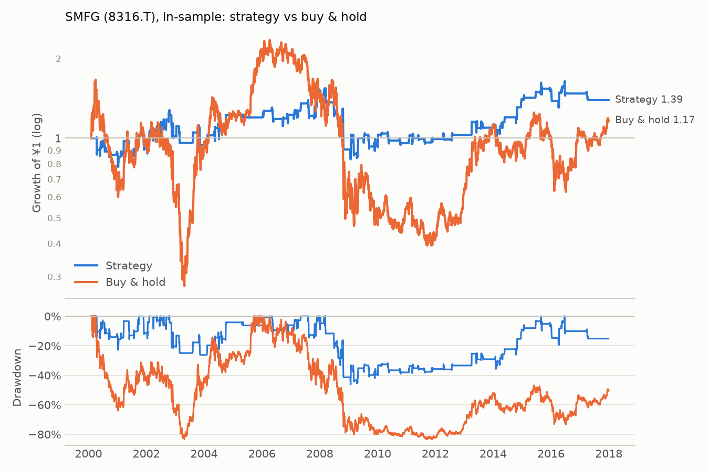

# SMFG (8316.T): in-sample

Period measured: 2000-02-03 to 2017-12-29

- Costs: 15 bps per side. Cash: JPY call rate, FRED `IRSTCI01JPM156N`.
- Rule: 5% below the 20-day MA, max hold 15 days, stop 10%, reset rule (see PREREGISTRATION.md).
- Data: `8316.T.csv` downloaded 2026-11-13, sha256 `83ee100a03a65113…`.

## Performance

| | CAGR | Vol | Sharpe | Max DD | In market | Trades | Win rate | Avg days | Avg trade | Gap trades |
|---|---:|---:|---:|---:|---:|---:|---:|---:|---:|---:|
| Strategy | 1.9% | 20.4% | 0.19 | -46.2% | 18.2% | 89 | 60.7% | 9.90 | 0.65% | 0 |
| Buy & hold | 0.9% | 42.3% | 0.23 | -83.4% | 100.0% | 0 | n/a | n/a | n/a | 1 |

## Trades

All 89 trades are in [trades.csv](trades.csv). Trades open across a data gap: 0.

_Generated by `run.py --period in-sample` on 2026-11-13._
