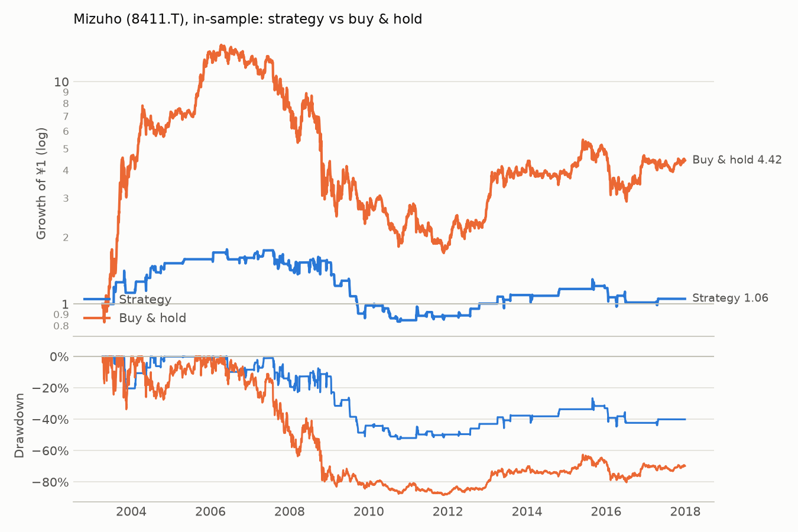

# Mizuho (8411.T): in-sample

Period measured: 2003-04-11 to 2017-12-29

- Costs: 15 bps per side. Cash: JPY call rate, FRED `IRSTCI01JPM156N`.
- Rule: 5% below the 20-day MA, max hold 15 days, stop 10%, reset rule (see PREREGISTRATION.md).
- Data: `8411.T.csv` downloaded 2026-11-13, sha256 `6757e5c755bdb586…`.

## Performance

| | CAGR | Vol | Sharpe | Max DD | In market | Trades | Win rate | Avg days | Avg trade | Gap trades |
|---|---:|---:|---:|---:|---:|---:|---:|---:|---:|---:|
| Strategy | 0.4% | 17.4% | 0.10 | -52.7% | 15.1% | 60 | 55.0% | 10.07 | 0.33% | 0 |
| Buy & hold | 10.6% | 40.1% | 0.45 | -88.4% | 100.0% | 0 | n/a | n/a | n/a | 1 |

## Trades

All 60 trades are in [trades.csv](trades.csv). Trades open across a data gap: 0.

_Generated by `run.py --period in-sample` on 2026-11-13._
