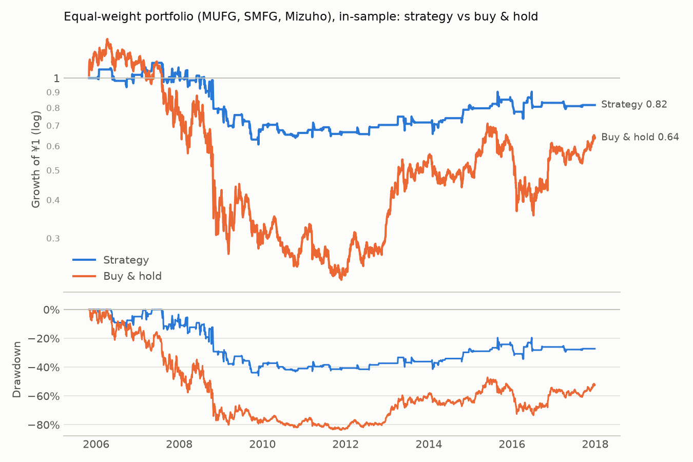
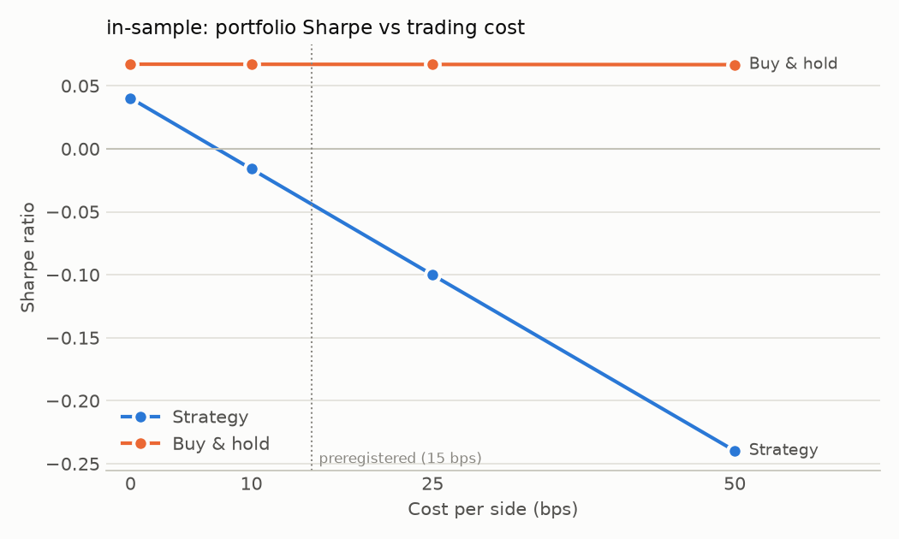
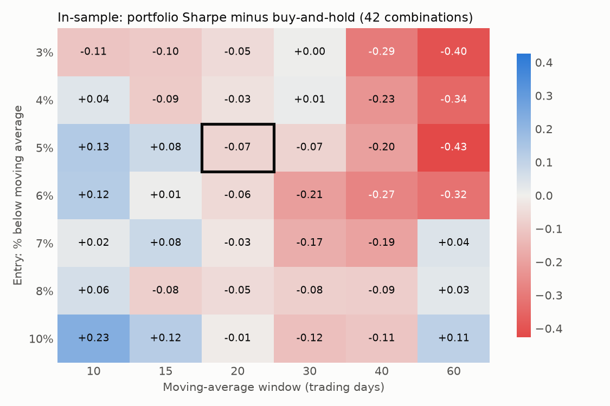

# Equal-weight portfolio (MUFG, SMFG, Mizuho): in-sample

Period measured: 2005-10-31 to 2017-12-29

- Costs: 15 bps per side. Cash: JPY call rate, FRED `IRSTCI01JPM156N`.
- Rule: 5% below the 20-day MA, max hold 15 days, stop 10%, reset rule (see PREREGISTRATION.md).
- Daily rebalanced to 1/3 each; rebalancing costs ignored.

## Performance

| | CAGR | Vol | Sharpe | Max DD | In market | Trades | Win rate | Avg days | Avg trade | Gap trades |
|---|---:|---:|---:|---:|---:|---:|---:|---:|---:|---:|
| Strategy | -1.7% | 15.3% | -0.04 | -45.9% | 16.7% | 153 | n/a | n/a | n/a | 0 |
| Buy & hold | -3.6% | 35.6% | 0.07 | -83.7% | 100.0% | 0 | n/a | n/a | n/a | 3 |



## Preregistered test (in-sample, FOR REFERENCE ONLY: the real test is out-of-sample)

| Criterion | Value | Met? |
|---|---|---|
| 1. Sharpe higher than buy & hold at 15 bps | -0.04 vs 0.07 | no |
| 2. 95% bootstrap interval of Sharpe difference entirely above 0 | [-0.63, 0.44] | no |
| 3. Sharpe still higher at 25 bps | -0.10 vs 0.07 | no |
| 4. At least 20 closed trades in total | 153 | yes |

Partial-result check:

| Condition | Value | Met? |
|---|---|---|
| Sharpe within ±0.10 of buy & hold | -0.11 | no |
| Max drawdown at least 10 points smaller | +37.7 points | yes |

**Mechanical outcome: DOES NOT WORK (by the preregistered criteria)**

Bootstrap: 5000 resamples, 21-day blocks, observed difference -0.111, share of resamples where the strategy is not better: 62.3%.

## Cost sensitivity

```
          strategy_sharpe  buy_hold_sharpe  strategy_cagr  buy_hold_cagr  trades
cost_bps                                                                        
0                   0.040            0.067         -0.004         -0.036     153
10                 -0.016            0.067         -0.012         -0.036     153
25                 -0.100            0.067         -0.025         -0.036     153
50                 -0.240            0.067         -0.045         -0.036     153
```



## Parameter grid (in-sample only)



Made by `robustness.py`. A diagnostic, not a way to pick settings.

_Generated by `run.py --period in-sample` on 2026-11-13._
