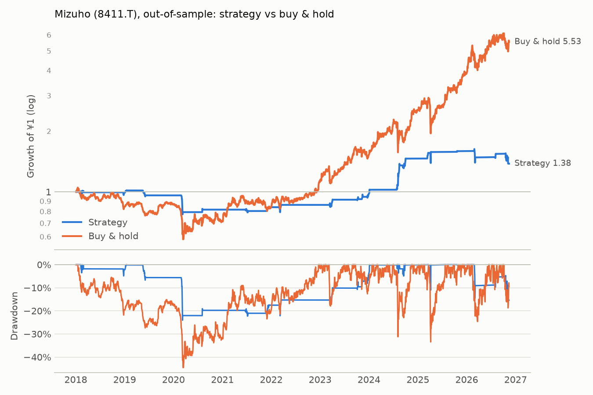

# Mizuho (8411.T): out-of-sample

Period measured: 2018-01-04 to 2026-11-13

- Costs: 15 bps per side. Cash: JPY call rate, FRED `IRSTCI01JPM156N`.
- Rule: 5% below the 20-day MA, max hold 15 days, stop 10%, reset rule (see PREREGISTRATION.md).
- Data: `8411.T.csv` downloaded 2026-11-13, sha256 `6757e5c755bdb586…`.

## Performance

| | CAGR | Vol | Sharpe | Max DD | In market | Trades | Win rate | Avg days | Avg trade | Gap trades |
|---|---:|---:|---:|---:|---:|---:|---:|---:|---:|---:|
| Strategy | 3.7% | 12.1% | 0.36 | -24.0% | 8.0% | 21 | 71.4% | 9.24 | 1.82% | 0 |
| Buy & hold | 21.3% | 28.6% | 0.84 | -44.6% | 100.0% | 0 | n/a | n/a | n/a | 1 |

## Trades

All 21 trades are in [trades.csv](trades.csv). Trades open across a data gap: 0.

_Generated by `run.py --period out-of-sample` on 2026-11-13._
