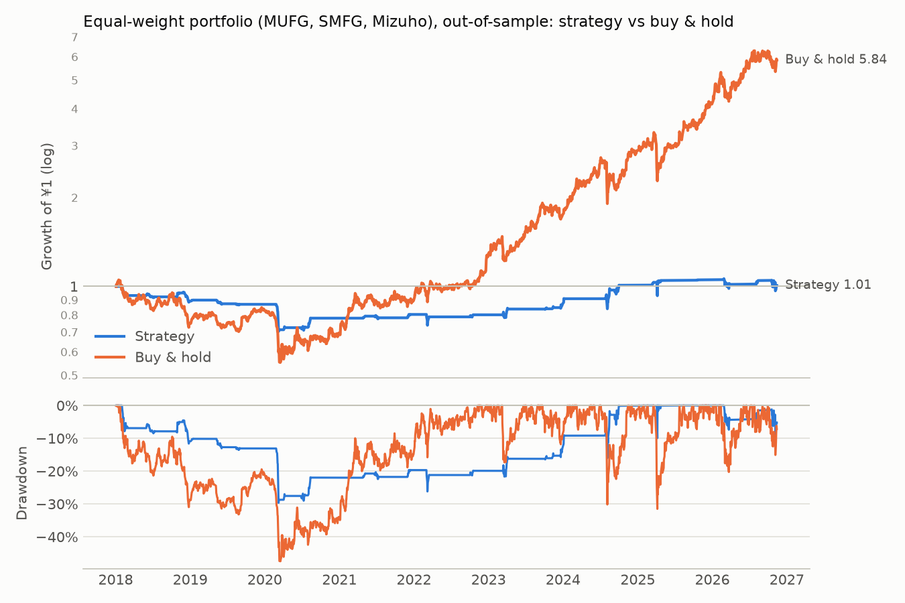
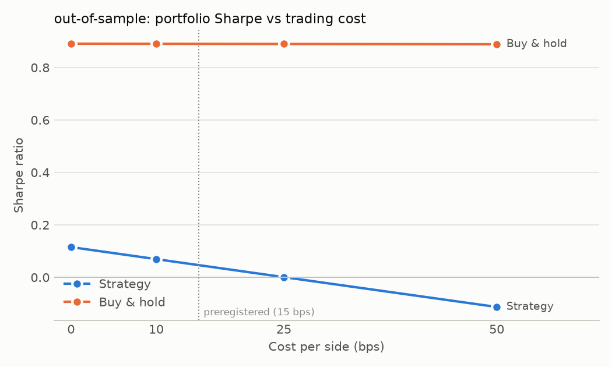

# Equal-weight portfolio (MUFG, SMFG, Mizuho): out-of-sample

Period measured: 2018-01-04 to 2026-11-13

- Costs: 15 bps per side. Cash: JPY call rate, FRED `IRSTCI01JPM156N`.
- Rule: 5% below the 20-day MA, max hold 15 days, stop 10%, reset rule (see PREREGISTRATION.md).
- Daily rebalanced to 1/3 each; rebalancing costs ignored.

## Performance

| | CAGR | Vol | Sharpe | Max DD | In market | Trades | Win rate | Avg days | Avg trade | Gap trades |
|---|---:|---:|---:|---:|---:|---:|---:|---:|---:|---:|
| Strategy | 0.1% | 10.2% | 0.05 | -29.7% | 8.6% | 60 | n/a | n/a | n/a | 0 |
| Buy & hold | 22.0% | 27.2% | 0.89 | -47.5% | 100.0% | 0 | n/a | n/a | n/a | 3 |



## Preregistered test

| Criterion | Value | Met? |
|---|---|---|
| 1. Sharpe higher than buy & hold at 15 bps | 0.05 vs 0.89 | no |
| 2. 95% bootstrap interval of Sharpe difference entirely above 0 | [-1.54, -0.15] | no |
| 3. Sharpe still higher at 25 bps | 0.00 vs 0.89 | no |
| 4. At least 20 closed trades in total | 60 | yes |

Partial-result check:

| Condition | Value | Met? |
|---|---|---|
| Sharpe within ±0.10 of buy & hold | -0.84 | no |
| Max drawdown at least 10 points smaller | +17.8 points | yes |

**Mechanical outcome: DOES NOT WORK (by the preregistered criteria)**

Bootstrap: 5000 resamples, 21-day blocks, observed difference -0.844, share of resamples where the strategy is not better: 99.2%.

## Cost sensitivity

```
          strategy_sharpe  buy_hold_sharpe  strategy_cagr  buy_hold_cagr  trades
cost_bps                                                                        
0                   0.115            0.891          0.008          0.221      60
10                  0.069            0.890          0.003          0.221      60
25                  0.001            0.890         -0.004          0.220      60
50                 -0.113            0.889         -0.015          0.220      60
```



_Generated by `run.py --period out-of-sample` on 2026-11-13._
