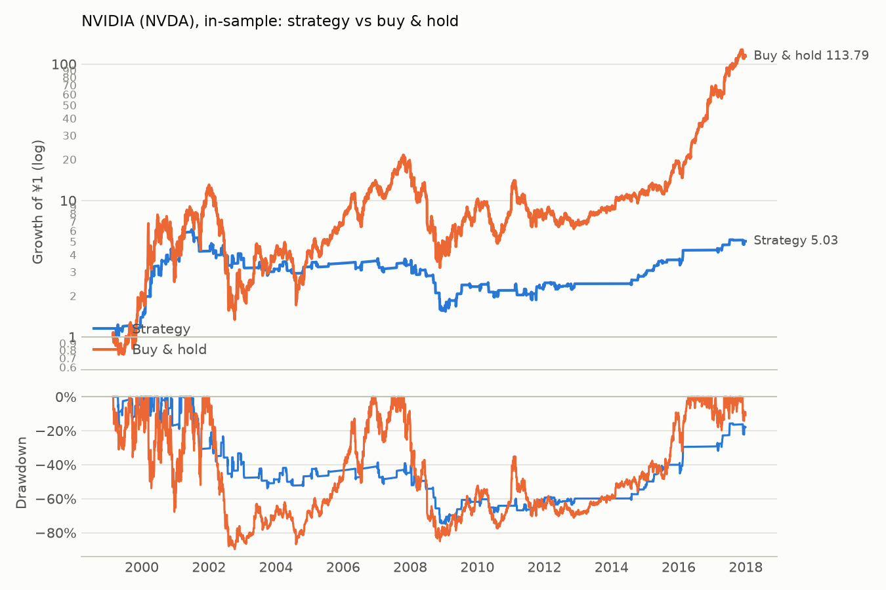
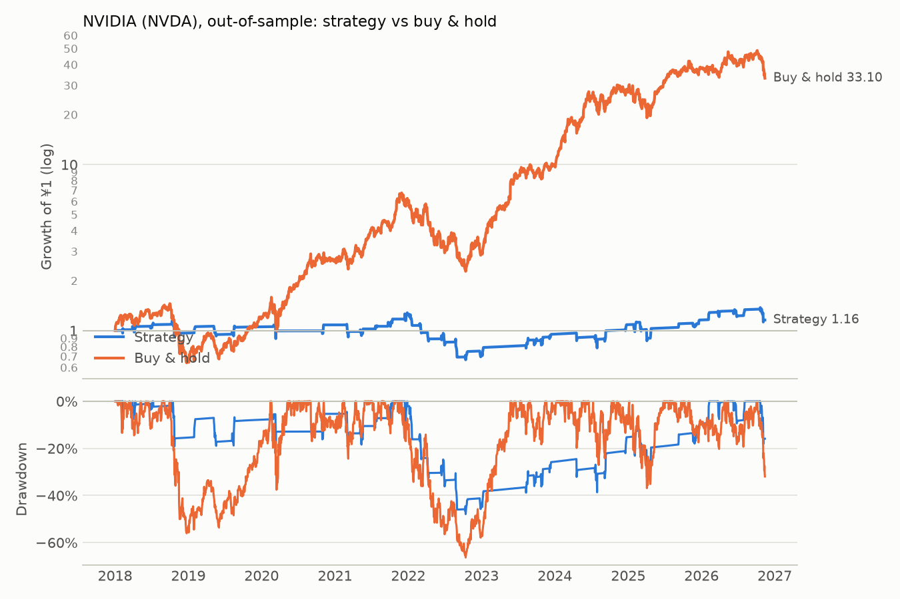

# NVIDIA (NVDA): backtest report

This is a report on how the preregistered mean-reversion rule did on NVIDIA
in this project's backtest. It is **not** a view on NVIDIA as a company and
**not** investment advice. Every number is copied from the results files in
this folder; what the numbers mean is in the README.

NVIDIA is one of three stocks in the US robustness test
([PREREGISTRATION_US.md](../../PREREGISTRATION_US.md)). That test is judged
on the three-stock portfolio. Per-stock results like these are secondary and
cannot change its outcome.

## Setup

| | |
|---|---|
| Rule | buy when the close is 5% or more below its 20-day moving average; sell at the first of: back to the average, 15 trading days held, 10% below the price paid |
| Execution | a decision at day t's close is traded at day t+1's close |
| Costs | 5 bps per side |
| Cash | earns the US fed funds rate (FRED `FEDFUNDS`) |
| Benchmark | buy-and-hold of NVDA, dividends included, same costs, same dates |
| Data | Yahoo Finance, dividend-adjusted; `NVDA.csv` downloaded 2026-11-14, sha256 `841bd5027917baa2…` |

## Data check (in-sample prices only)

- First price: 1999-01-22. In-sample trading days: 4,767.
- Rows removed by cleaning: 0. Gaps over 7 calendar days: 0. Runs of 5+ identical closes: 0.
- Daily moves over 20%: 16, kept (not checked against a second source).
- Entry episodes (upper bound on chances to trade): 5.71 a year.

## Results

| | In-sample: strategy | In-sample: buy & hold | Out-of-sample: strategy | Out-of-sample: buy & hold |
|---|---:|---:|---:|---:|
| Period | 1999-02-23 to 2017-12-29 | same | 2018-01-02 to 2026-11-13 | same |
| CAGR | 8.9% | 28.6% | 1.7% | 48.4% |
| Volatility | 25.7% | 62.7% | 21.5% | 50.3% |
| Sharpe | 0.39 | 0.68 | 0.06 | 0.99 |
| Max drawdown | -74.9% | -89.7% | -47.9% | -66.3% |
| Time in market | 16.9% | 100% | 14.5% | 100% |
| Closed trades | 108 | n/a | 43 | n/a |
| Win rate | 56.5% | n/a | 60.5% | n/a |
| Average days held | 8.44 | n/a | 8.53 | n/a |
| Average trade | +1.80% | n/a | +0.23% | n/a |

The out-of-sample period was run once, as preregistered.

### In-sample: equity and drawdown

### Out-of-sample: equity and drawdown

## Why trades ended

| Exit | In-sample: trades | Win rate | Avg return | Out-of-sample: trades | Win rate | Avg return |
|---|---:|---:|---:|---:|---:|---:|
| Back to MA | 65 | 87.7% | +8.31% | 28 | 92.9% | +5.59% |
| Stop-loss | 27 | 0.0% | -11.45% | 12 | 0.0% | -10.12% |
| Time stop | 16 | 25.0% | -2.31% | 3 | 0.0% | -8.44% |

No trade was open at the end of either period, and none crossed a data gap.

## Largest trades (net of costs)

| Period | Bought | Sold | Days held | Return | Exit |
|---|---|---|---:|---:|---|
| In-sample, best | 2000-03-29 | 2000-04-07 | 8 | +36.2% | back to MA |
| In-sample, best | 2001-02-08 | 2001-02-16 | 7 | +33.2% | back to MA |
| In-sample, best | 2000-01-27 | 2000-02-11 | 12 | +29.7% | back to MA |
| In-sample, worst | 2001-09-05 | 2001-09-18 | 6 | -20.7% | stop-loss |
| In-sample, worst | 2008-11-17 | 2008-11-20 | 4 | -16.0% | stop-loss |
| In-sample, worst | 2000-11-21 | 2000-11-29 | 6 | -16.0% | stop-loss |
| Out-of-sample, best | 2025-04-21 | 2025-04-25 | 5 | +14.4% | back to MA |
| Out-of-sample, best | 2024-09-04 | 2024-09-13 | 8 | +12.0% | back to MA |
| Out-of-sample, best | 2026-02-05 | 2026-02-09 | 3 | +10.5% | back to MA |
| Out-of-sample, worst | 2022-08-23 | 2022-09-01 | 8 | -19.0% | stop-loss |
| Out-of-sample, worst | 2022-01-06 | 2022-01-20 | 10 | -14.4% | stop-loss |
| Out-of-sample, worst | 2026-10-19 | 2026-11-06 | 15 | -14.1% | time stop |

## Out-of-sample trades by year bought

| Year | 2018 | 2019 | 2020 | 2021 | 2022 | 2023 | 2024 | 2025 | 2026 |
|---|---:|---:|---:|---:|---:|---:|---:|---:|---:|
| Trades | 4 | 3 | 3 | 6 | 7 | 4 | 4 | 7 | 5 |
| Sum of trade returns | -0.04 | +0.08 | +0.03 | +0.16 | -0.43 | +0.15 | +0.10 | +0.06 | -0.00 |

"Sum of trade returns" adds each trade's net return (0.10 = 10%); it is not a
compounded yearly return.

## Source files

- [in-sample/NVDA/results.md](in-sample/NVDA/results.md) and [trades.csv](in-sample/NVDA/trades.csv)
- [out-of-sample/NVDA/results.md](out-of-sample/NVDA/results.md) and [trades.csv](out-of-sample/NVDA/trades.csv)

_Compiled on 2026-11-14 from the files above. The largest-trades and by-year
tables are computed from the two `trades.csv` files._
