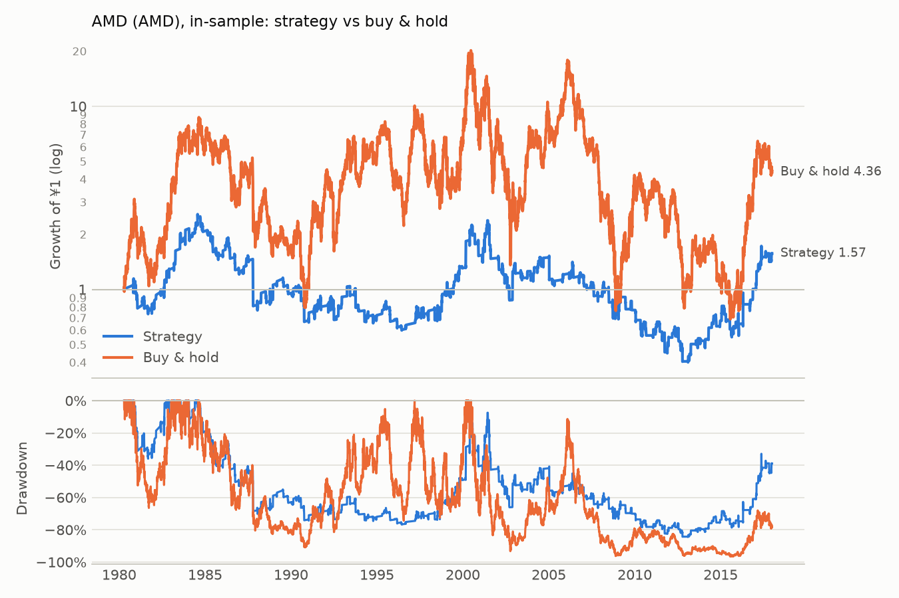

# AMD (AMD): in-sample

Period measured: 1980-04-16 to 2017-12-29

- Costs: 5 bps per side. Cash: USD fed funds rate, FRED `FEDFUNDS`.
- Rule: 5% below the 20-day MA, max hold 15 days, stop 10%, reset rule (see PREREGISTRATION_US.md).
- Data: `AMD.csv` downloaded 2026-11-14, sha256 `bbd76e3dd3576e9a…`.

## Performance

| | CAGR | Vol | Sharpe | Max DD | In market | Trades | Win rate | Avg days | Avg trade | Gap trades |
|---|---:|---:|---:|---:|---:|---:|---:|---:|---:|---:|
| Strategy | 1.2% | 28.0% | 0.02 | -84.4% | 19.6% | 233 | 54.5% | 9.02 | 0.20% | 0 |
| Buy & hold | 4.0% | 59.9% | 0.29 | -96.6% | 100.0% | 0 | n/a | n/a | n/a | 0 |

## Trades

All 233 trades are in [trades.csv](trades.csv). Trades open across a data gap: 0.

### Why trades ended (closed trades)

| Exit | Trades | Win rate | Avg return | Sum of returns |
|---|---:|---:|---:|---:|
| back to MA | 132 | 90.9% | +7.43% | +9.81 |
| stop-loss | 62 | 0.0% | -12.67% | -7.86 |
| time stop | 39 | 17.9% | -3.84% | -1.50 |

_Generated by `run.py --period in-sample` on 2026-11-14._
