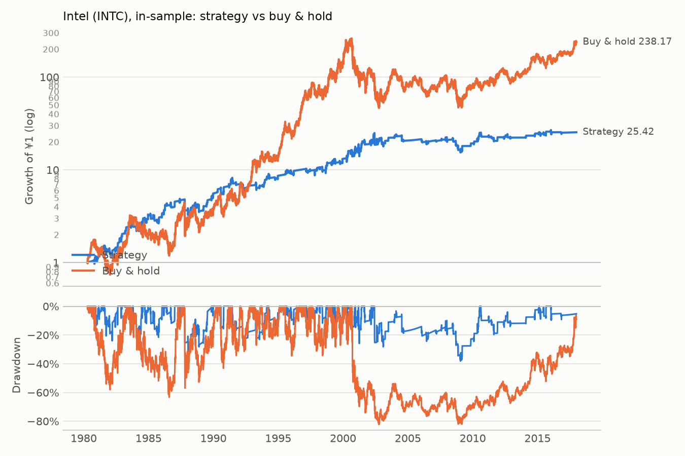

# Intel (INTC): in-sample

Period measured: 1980-04-16 to 2017-12-29

- Costs: 5 bps per side. Cash: USD fed funds rate, FRED `FEDFUNDS`.
- Rule: 5% below the 20-day MA, max hold 15 days, stop 10%, reset rule (see PREREGISTRATION_US.md).
- Data: `INTC.csv` downloaded 2026-11-14, sha256 `d5e8ba81b0e86c0f…`.

## Performance

| | CAGR | Vol | Sharpe | Max DD | In market | Trades | Win rate | Avg days | Avg trade | Gap trades |
|---|---:|---:|---:|---:|---:|---:|---:|---:|---:|---:|
| Strategy | 9.0% | 18.7% | 0.31 | -38.1% | 16.0% | 171 | 62.6% | 9.92 | 1.38% | 0 |
| Buy & hold | 15.6% | 40.0% | 0.45 | -82.2% | 100.0% | 0 | n/a | n/a | n/a | 0 |

## Trades

All 171 trades are in [trades.csv](trades.csv). Trades open across a data gap: 0.

### Why trades ended (closed trades)

| Exit | Trades | Win rate | Avg return | Sum of returns |
|---|---:|---:|---:|---:|
| back to MA | 106 | 94.3% | +6.04% | +6.40 |
| stop-loss | 24 | 0.0% | -10.79% | -2.59 |
| time stop | 41 | 17.1% | -3.56% | -1.46 |

_Generated by `run.py --period in-sample` on 2026-11-14._
