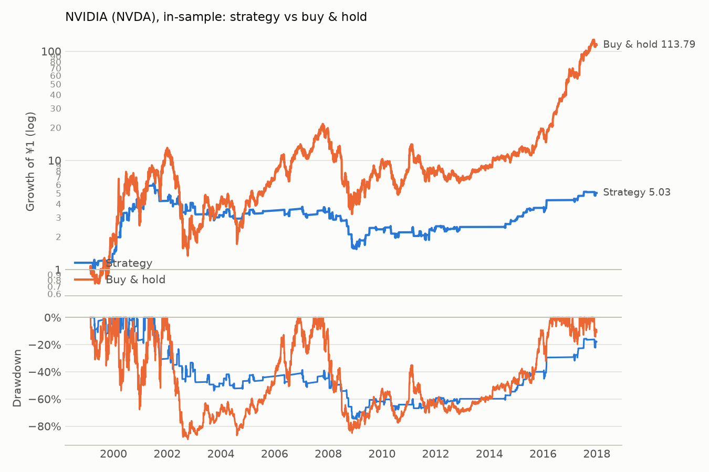

# NVIDIA (NVDA): in-sample

Period measured: 1999-02-23 to 2017-12-29

- Costs: 5 bps per side. Cash: USD fed funds rate, FRED `FEDFUNDS`.
- Rule: 5% below the 20-day MA, max hold 15 days, stop 10%, reset rule (see PREREGISTRATION_US.md).
- Data: `NVDA.csv` downloaded 2026-11-14, sha256 `841bd5027917baa2…`.

## Performance

| | CAGR | Vol | Sharpe | Max DD | In market | Trades | Win rate | Avg days | Avg trade | Gap trades |
|---|---:|---:|---:|---:|---:|---:|---:|---:|---:|---:|
| Strategy | 8.9% | 25.7% | 0.39 | -74.9% | 16.9% | 108 | 56.5% | 8.44 | 1.80% | 0 |
| Buy & hold | 28.6% | 62.7% | 0.68 | -89.7% | 100.0% | 0 | n/a | n/a | n/a | 0 |

## Trades

All 108 trades are in [trades.csv](trades.csv). Trades open across a data gap: 0.

### Why trades ended (closed trades)

| Exit | Trades | Win rate | Avg return | Sum of returns |
|---|---:|---:|---:|---:|
| back to MA | 65 | 87.7% | +8.31% | +5.40 |
| stop-loss | 27 | 0.0% | -11.45% | -3.09 |
| time stop | 16 | 25.0% | -2.31% | -0.37 |

_Generated by `run.py --period in-sample` on 2026-11-14._
