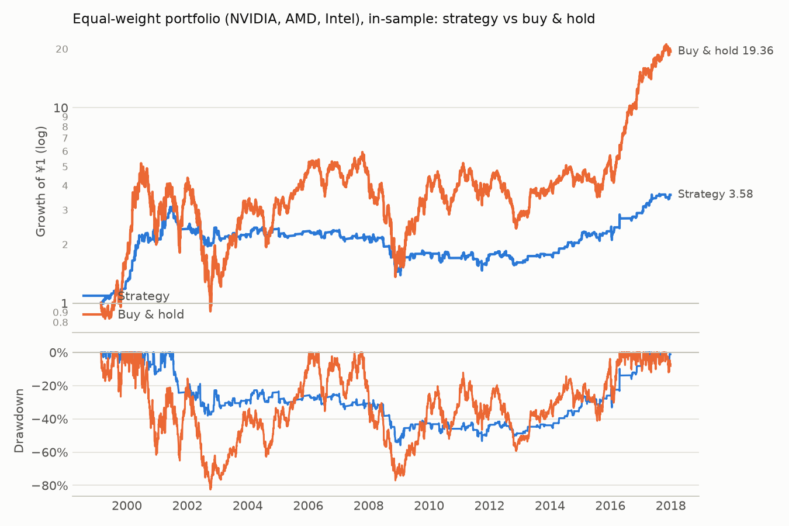
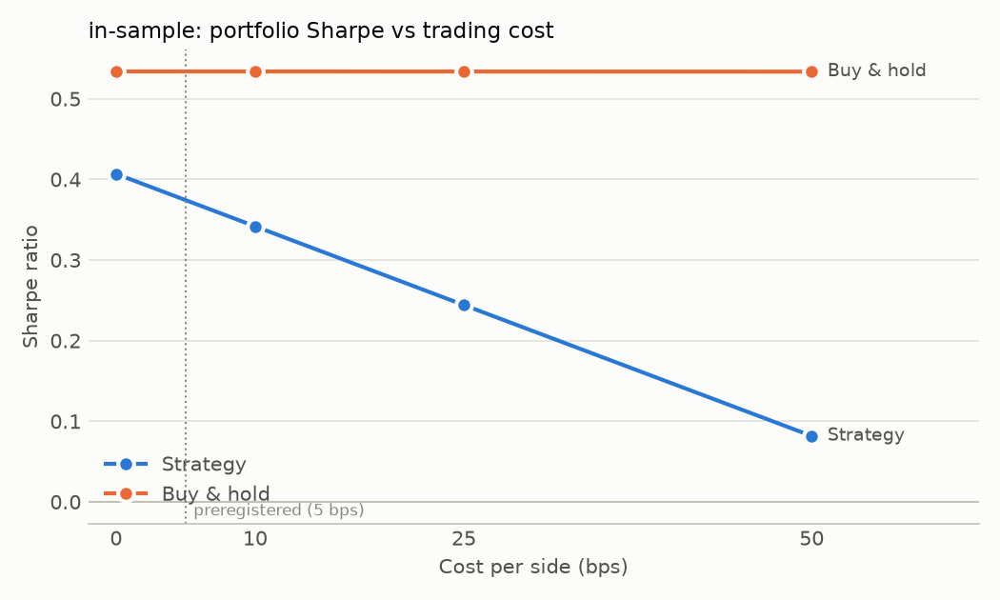
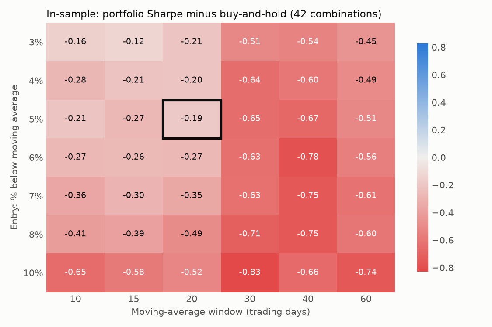

# Equal-weight portfolio (NVIDIA, AMD, Intel): in-sample

Period measured: 1999-02-23 to 2017-12-29

- Costs: 5 bps per side. Cash: USD fed funds rate, FRED `FEDFUNDS`.
- Rule: 5% below the 20-day MA, max hold 15 days, stop 10%, reset rule (see PREREGISTRATION_US.md).
- Daily rebalanced to 1/3 each; rebalancing costs ignored.

## Performance

| | CAGR | Vol | Sharpe | Max DD | In market | Trades | Win rate | Avg days | Avg trade | Gap trades |
|---|---:|---:|---:|---:|---:|---:|---:|---:|---:|---:|
| Strategy | 7.0% | 16.9% | 0.37 | -55.9% | 17.1% | 310 | n/a | n/a | n/a | 0 |
| Buy & hold | 17.0% | 44.2% | 0.53 | -82.5% | 100.0% | 0 | n/a | n/a | n/a | 0 |



## Preregistered test (in-sample, FOR REFERENCE ONLY: the real test is out-of-sample)

| Criterion | Value | Met? |
|---|---|---|
| 1. Sharpe higher than buy & hold at 5 bps | 0.37 vs 0.53 | no |
| 2. 95% bootstrap interval of Sharpe difference entirely above 0 | [-0.57, 0.22] | no |
| 3. Sharpe still higher at 25 bps | 0.24 vs 0.53 | no |
| 4. At least 20 closed trades in total | 310 | yes |

Partial-result check:

| Condition | Value | Met? |
|---|---|---|
| Sharpe within ±0.10 of buy & hold | -0.16 | no |
| Max drawdown at least 10 points smaller | +26.6 points | yes |

**Mechanical outcome: DOES NOT WORK (by the preregistered criteria)**

Bootstrap: 5000 resamples, 21-day blocks, observed difference -0.160, share of resamples where the strategy is not better: 79.8%.

## Why trades ended, all three stocks (closed trades)

| Exit | Trades | Win rate | Avg return | Sum of returns |
|---|---:|---:|---:|---:|
| back to MA | 303 | 91.4% | +7.13% | +21.61 |
| stop-loss | 113 | 0.0% | -11.98% | -13.54 |
| time stop | 96 | 18.8% | -3.46% | -3.32 |

## Cost sensitivity

```
          strategy_sharpe  buy_hold_sharpe  strategy_cagr  buy_hold_cagr  trades
cost_bps                                                                        
0                   0.407            0.534          0.076           0.17     310
10                  0.342            0.534          0.064           0.17     310
25                  0.244            0.534          0.047           0.17     310
50                  0.082            0.534          0.018           0.17     310
```



## Parameter grid (in-sample only)



Made by `robustness.py`. A diagnostic, not a way to pick settings.

_Generated by `run.py --period in-sample` on 2026-11-14._
