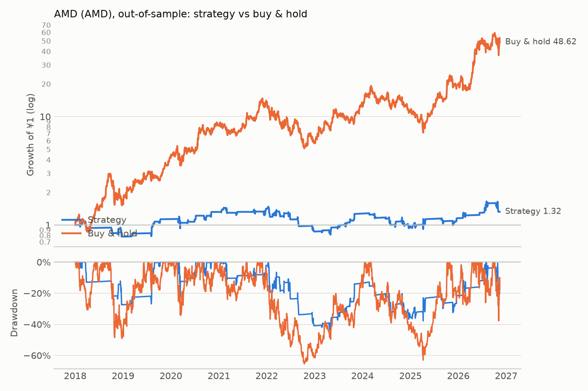

# AMD (AMD): out-of-sample

Period measured: 2018-01-02 to 2026-11-13

- Costs: 5 bps per side. Cash: USD fed funds rate, FRED `FEDFUNDS`.
- Rule: 5% below the 20-day MA, max hold 15 days, stop 10%, reset rule (see PREREGISTRATION_US.md).
- Data: `AMD.csv` downloaded 2026-11-14, sha256 `bbd76e3dd3576e9a…`.

## Performance

| | CAGR | Vol | Sharpe | Max DD | In market | Trades | Win rate | Avg days | Avg trade | Gap trades |
|---|---:|---:|---:|---:|---:|---:|---:|---:|---:|---:|
| Strategy | 3.2% | 26.8% | 0.15 | -44.8% | 20.8% | 57 | 59.6% | 9.14 | 0.52% | 0 |
| Buy & hold | 55.0% | 57.5% | 1.00 | -65.4% | 100.0% | 0 | n/a | n/a | n/a | 0 |

## Trades

All 57 trades are in [trades.csv](trades.csv). Trades open across a data gap: 0.

### Why trades ended (closed trades)

| Exit | Trades | Win rate | Avg return | Sum of returns |
|---|---:|---:|---:|---:|
| back to MA | 36 | 88.9% | +5.36% | +1.93 |
| stop-loss | 12 | 0.0% | -12.46% | -1.49 |
| time stop | 9 | 22.2% | -1.53% | -0.14 |

_Generated by `run.py --period out-of-sample` on 2026-11-14._
