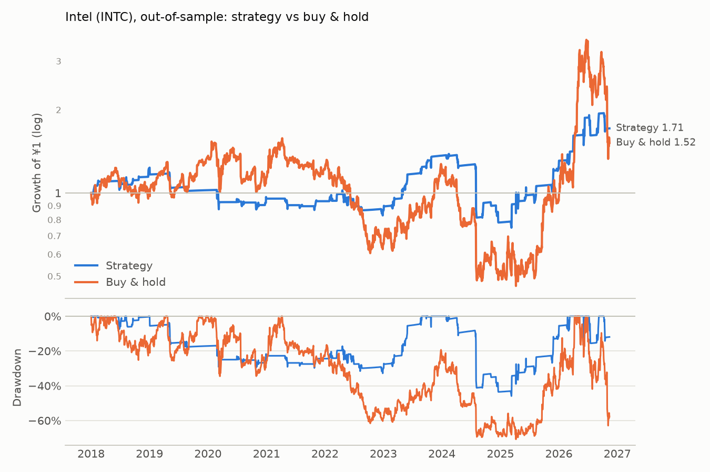

# Intel (INTC): out-of-sample

Period measured: 2018-01-02 to 2026-11-13

- Costs: 5 bps per side. Cash: USD fed funds rate, FRED `FEDFUNDS`.
- Rule: 5% below the 20-day MA, max hold 15 days, stop 10%, reset rule (see PREREGISTRATION_US.md).
- Data: `INTC.csv` downloaded 2026-11-14, sha256 `d5e8ba81b0e86c0f…`.

## Performance

| | CAGR | Vol | Sharpe | Max DD | In market | Trades | Win rate | Avg days | Avg trade | Gap trades |
|---|---:|---:|---:|---:|---:|---:|---:|---:|---:|---:|
| Strategy | 6.3% | 22.9% | 0.27 | -45.9% | 20.3% | 49 | 61.2% | 10.24 | 1.19% | 0 |
| Buy & hold | 4.8% | 50.0% | 0.29 | -70.8% | 100.0% | 0 | n/a | n/a | n/a | 0 |

## Trades

All 49 trades are in [trades.csv](trades.csv). Trades open across a data gap: 0.

### Why trades ended (closed trades)

| Exit | Trades | Win rate | Avg return | Sum of returns |
|---|---:|---:|---:|---:|
| back to MA | 33 | 87.9% | +5.64% | +1.86 |
| stop-loss | 7 | 0.0% | -14.98% | -1.05 |
| time stop | 9 | 11.1% | -2.56% | -0.23 |

_Generated by `run.py --period out-of-sample` on 2026-11-14._
