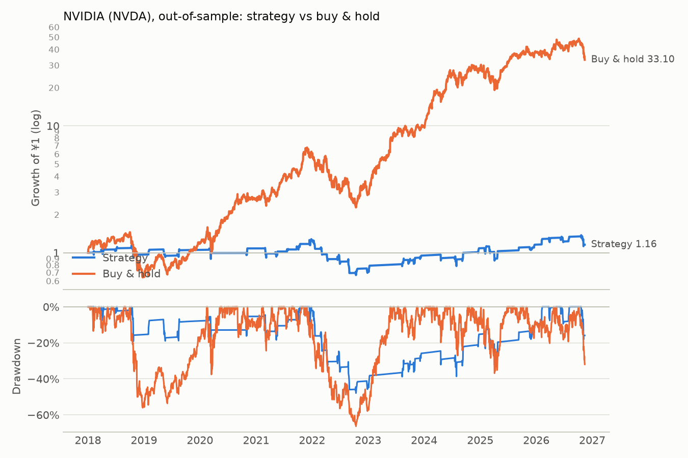

# NVIDIA (NVDA): out-of-sample

Period measured: 2018-01-02 to 2026-11-13

- Costs: 5 bps per side. Cash: USD fed funds rate, FRED `FEDFUNDS`.
- Rule: 5% below the 20-day MA, max hold 15 days, stop 10%, reset rule (see PREREGISTRATION_US.md).
- Data: `NVDA.csv` downloaded 2026-11-14, sha256 `841bd5027917baa2…`.

## Performance

| | CAGR | Vol | Sharpe | Max DD | In market | Trades | Win rate | Avg days | Avg trade | Gap trades |
|---|---:|---:|---:|---:|---:|---:|---:|---:|---:|---:|
| Strategy | 1.7% | 21.5% | 0.06 | -47.9% | 14.5% | 43 | 60.5% | 8.53 | 0.23% | 0 |
| Buy & hold | 48.4% | 50.3% | 0.99 | -66.3% | 100.0% | 0 | n/a | n/a | n/a | 0 |

## Trades

All 43 trades are in [trades.csv](trades.csv). Trades open across a data gap: 0.

### Why trades ended (closed trades)

| Exit | Trades | Win rate | Avg return | Sum of returns |
|---|---:|---:|---:|---:|
| back to MA | 28 | 92.9% | +5.59% | +1.57 |
| stop-loss | 12 | 0.0% | -10.12% | -1.21 |
| time stop | 3 | 0.0% | -8.44% | -0.25 |

_Generated by `run.py --period out-of-sample` on 2026-11-14._
