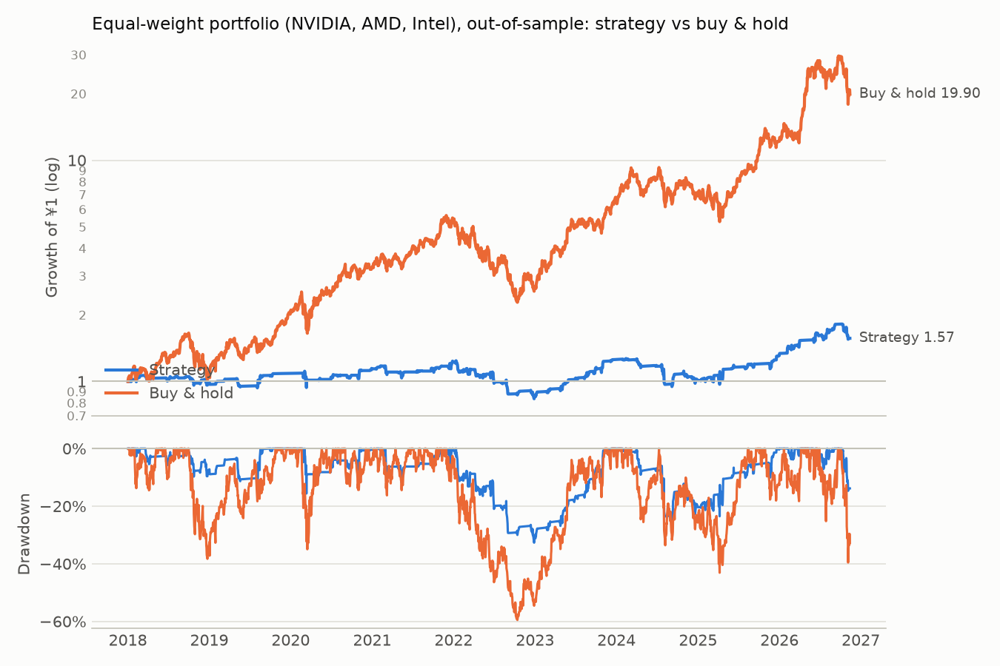
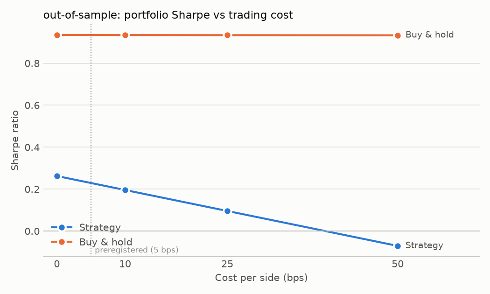

# Equal-weight portfolio (NVIDIA, AMD, Intel): out-of-sample

Period measured: 2018-01-02 to 2026-11-13

- Costs: 5 bps per side. Cash: USD fed funds rate, FRED `FEDFUNDS`.
- Rule: 5% below the 20-day MA, max hold 15 days, stop 10%, reset rule (see PREREGISTRATION_US.md).
- Daily rebalanced to 1/3 each; rebalancing costs ignored.

## Performance

| | CAGR | Vol | Sharpe | Max DD | In market | Trades | Win rate | Avg days | Avg trade | Gap trades |
|---|---:|---:|---:|---:|---:|---:|---:|---:|---:|---:|
| Strategy | 5.2% | 16.8% | 0.23 | -32.7% | 18.6% | 149 | n/a | n/a | n/a | 0 |
| Buy & hold | 40.1% | 43.5% | 0.93 | -59.5% | 100.0% | 0 | n/a | n/a | n/a | 0 |



## Preregistered test

| Criterion | Value | Met? |
|---|---|---|
| 1. Sharpe higher than buy & hold at 5 bps | 0.23 vs 0.93 | no |
| 2. 95% bootstrap interval of Sharpe difference entirely above 0 | [-1.28, -0.12] | no |
| 3. Sharpe still higher at 25 bps | 0.10 vs 0.93 | no |
| 4. At least 20 closed trades in total | 149 | yes |

Partial-result check:

| Condition | Value | Met? |
|---|---|---|
| Sharpe within ±0.10 of buy & hold | -0.71 | no |
| Max drawdown at least 10 points smaller | +26.8 points | yes |

**Mechanical outcome: DOES NOT WORK (by the preregistered criteria)**

Bootstrap: 5000 resamples, 21-day blocks, observed difference -0.705, share of resamples where the strategy is not better: 99.2%.

## Why trades ended, all three stocks (closed trades)

| Exit | Trades | Win rate | Avg return | Sum of returns |
|---|---:|---:|---:|---:|
| back to MA | 97 | 89.7% | +5.52% | +5.36 |
| stop-loss | 31 | 0.0% | -12.12% | -3.76 |
| time stop | 21 | 14.3% | -2.96% | -0.62 |

## Cost sensitivity

```
          strategy_sharpe  buy_hold_sharpe  strategy_cagr  buy_hold_cagr  trades
cost_bps                                                                        
0                   0.263            0.935          0.058          0.401     149
10                  0.196            0.934          0.046          0.401     149
25                  0.096            0.934          0.029          0.401     149
50                 -0.070            0.933          0.000          0.401     149
```



_Generated by `run.py --period out-of-sample` on 2026-11-14._
